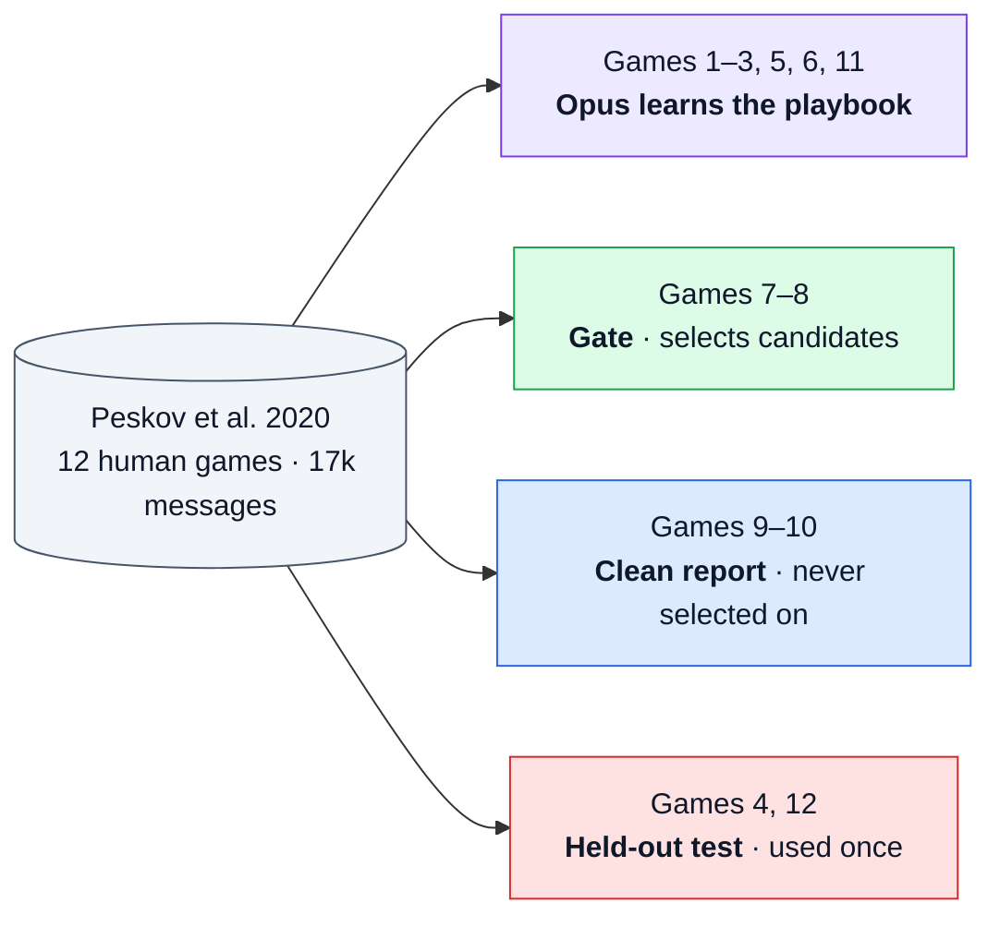
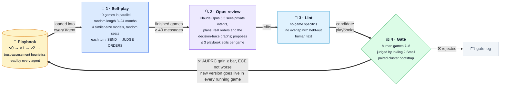
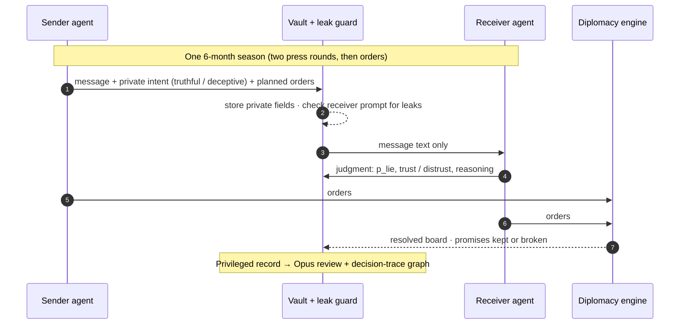
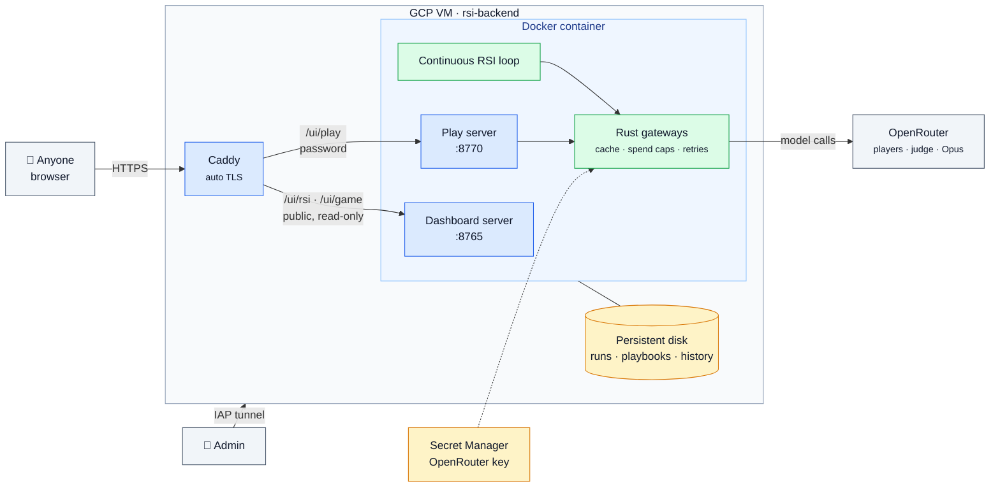

# Technical report: a self-play RSI harness for reasoning-traced trust decisions in Diplomacy

**Repository:** https://github.com/adi274903/diplomacy-rsi-harness · **Live deployment:** https://34-59-183-174.sslip.io/ui/rsi/
**Period covered:** 2026-11-22 to 2026-11-23 · **Status:** built, deployed, evaluated; background loop paused (API budget spent)

---

## Abstract

We built a harness in which large-language-model agents play the board game Diplomacy against each other. They negotiate in private messages, label their own messages as truthful or deceptive, and judge every message they receive with a lie probability. A stronger model, **Claude Opus 5.5**, acts as a privileged judge: it sees everything, reviews finished games together with each agent's *decision-trace graph*, and rewrites a shared **trust-assessment playbook**. A statistical gate accepts a rewrite only if it improves lie detection on **real human Diplomacy games** from the deception dataset of Peskov et al. (ACL 2020). Accepted playbooks are swapped into every running game immediately. No model weights are trained; all learning happens at the prompt level.

**Scale:** 153 completed self-play games with real models (about 2,800 negotiation messages), 117 game reviews by Opus, 69 candidate playbooks gated, and a 1,200-message held-out human test.

**Main results:**
1. **Opus learned a playbook from labelled human games** (human-v2). On the held-out human test set it raised AUPRC from 0.150 to **0.195** (95% CI of the gain [+0.016, +0.087]) and halved calibration error (ECE 0.275 → 0.143). The model with this playbook ranks lies better than the human receivers did (AUROC **0.73** vs 0.58).
2. **The self-play loop produced an accepted refinement** (rsi-v1). Opus derived it from reviewing self-play games. On human gate games it raised AUPRC from 0.107 to **0.142** and lie-F1 from 0.072 to **0.152**, at 99% bootstrap confidence.
3. **On the paper's headline metric, lie-F1 at a fixed 0.5 cutoff on the test set, we do not beat the supervised baselines:** 18.4 vs 20.9 (Context LSTM+Power+BERT), 27.0 (best model) and 22.5 (humans).
4. **The loop is "iterated self-improvement with an external critic", not strong RSI:** the critic itself never improves, and gains flattened: across the cloud runs, 2 of 69 candidate playbooks were accepted.

---

## 1. Problem and goal

**Task.** A *receiver* reads a message from another player and must estimate the probability that the sender intends to deceive it (p_lie), then decide whether to trust or distrust it. This is *subjective decision-making under strategic deception*:
- the ground truth is the sender's private intent
- humans are poor at it (receivers in the dataset caught only 8–20% of lies)
- lies are rare (4–9% of messages)

**Goal.** Build a recursive-self-improvement (RSI) style harness in which:
1. agents generate fresh decision data by actually playing;
2. a judge with full visibility learns from their reasoning traces and decisions;
3. the agents' decision policy, a playbook, improves over time;
4. improvement is measured on uncontaminated human data, not on the agents' own games.

**Constraints that shaped the design** (all decided during the build):
- **Hosted APIs only, no weight training.** Learning is prompt/playbook-level.
- **OpenRouter as the single provider,** with a hard $50 key limit.
- **Similar-size player models,** so no model wins on size alone.
- **Models rotate across countries,** so model strength is not confounded with starting position.

---

## 2. Data: the human deception benchmark

Peskov et al. 2020, *It Takes Two to Lie: One to Lie, and One to Listen* ([data](https://github.com/DenisPeskoff/2020_acl_diplomacy)). Every message is labelled by its sender (truthful or deceptive) and by its receiver (suspected or trusted).

| Split | Games | Dialogs | Messages | Lies | Lie rate | Receivers caught |
|---|---|---|---|---|---|---|
| train | 1–3, 5–10 | 189 | 13,132 | 591 | 4.5% | 11.9% |
| validation | 11 | 21 | 1,416 | 56 | 4.0% | 8.0% |
| test | 4, 12 | 42 | 2,741 | 240 | 8.8% | 20.3% |

**How each split is used:**

| Use | Games | Notes |
|---|---|---|
| Opus learns the human playbook | 1, 2, 3, 5, 6, 11 | |
| Gate: candidate selection | 7–8 | 216 items, 72 lies; all lies plus 2 truths per lie, weighted back to the natural rate |
| Clean final report | 9–10 | Never used for selection |
| Held-out test | 4, 12 | Evaluated once; guarded by a `TEST_LOCK` file |

**Pitfalls handled in the loader** (`rsi/human_data.py`):
- `sender_labels == false` means a **lie**.
- `receiver_labels` mixes booleans with `"NOANNOTATION"`.
- Scores and years are strings.
- The README names the field `score_delta`, but the data uses `game_score_delta`.
- The repo's `singlemessage_format.py` shuffles messages, which destroys context, so it is not used.
- The repo name is spelled `DenisPeskoff`, with a double "f".

---

## 3. System architecture

**The improvement loop**

**One season of play** (two press rounds, then orders)

### 3.1 Components

| Component | Path | Purpose |
|---|---|---|
| Game environment | `rsi/env/` | Wrapper over the MILA adjudicator (any map, subset of active powers, legal-order validation, SVG rendering). Private message bus. **Vault** holding each player's private intent, plan, memory and reasoning. |
| Isolation | `rsi/env/vault.py`, `crates/rsi-core/src/leak.rs` | Two checks on every player prompt. **Structural:** a player only sees dialogs it is part of. **Content:** an Aho-Corasick scan for other players' private texts. A game with any leak is marked invalid. |
| Agents | `rsi/agents/player.py`, `human.py` | Model players (send / judge / orders, strict JSON schemas). `HumanSeat` is a drop-in for live human play. |
| Reviewer | `rsi/agents/reviewer.py` | Opus review, run in chunks: per-message grades, promise kept/broken, reasoning quality, leak flags, playbook diffs. |
| Decision-trace graph | `rsi/causal.py`, `rsi/decision_graph.py` | Per phase: plan → message → judgment → later reasoning that cites the judgment → orders → supply-centre change. Optional structured judgments (claims, evidence, log-odds adjustments) with automatic consistency checks (merged PR #1). |
| Playbook evolution | `rsi/genome.py`, `rsi/evolve.py` | Content-hashed genomes. Diffs are linted, deduplicated and voted on; candidates come from top diffs, random subsets and mined exemplars. Pareto front over (AUPRC, −ECE). |
| Gate | `rsi/gate.py`, `rsi/score.py`, `crates/rsi-core` | Weighted metrics (identical to sklearn). Paired **cluster** bootstrap, resampling whole dialogs. Accepts a candidate only if p_gain ≥ the bar and ECE ≤ +0.02. |
| Learning from humans | `rsi/learn_human.py` | Opus reads batches of labelled human messages and extracts lessons, then merges them into ≤ 20 heuristics. Test and gate games are held out and linted against. |
| Loops | `rsi/loop.py`, `rsi/cadence.py`, `rsi/continuous.py` | Generation-based loop, fixed-cadence loop, and the **event-driven continuous loop** that was used in production. |
| Contamination | `rsi/contamination.py` | 8-gram index over held-out human text, memorisation probe, paraphrased test set. |
| Gateway | `crates/rsi-gateway` (Rust) | OpenAI-compatible proxy: content-addressed response cache, USD/token budget using provider-reported cost, retries that honour `Retry-After`, strict-priority admission, `/stats` and `/metrics`, a load generator. |
| UIs | `web/game`, `web/rsi`, `web/play`, `rsi/viewer.py`, `rsi/webapi.py` | Live spectator view, RSI dashboard (versions, gate decisions, F1, standings, graph explorer), play page. |
| Deployment | `Dockerfile`, `deploy/` | One container (gateways + loop + dashboards + play server). GCP VM, Secret Manager, IAP and HTTPS. |

**Size:** about 6,400 lines of Python, 2,000 of Rust, 4,100 of web front end and 800 of tests.
**Tests:** 43 Python and 15 Rust tests; CI on every push.

### 3.2 Models

| Role | Model (OpenRouter) | Why |
|---|---|---|
| Players (rotating across countries) | Inkling 2 Mini, Qwen3.6-35B-A3B, Gemma 4 26B-A4B, Nemotron 3 Nano 30B-A3B | Open reasoning MoEs of the same class: 25–35B total parameters, 3–4B active |
| Lie judge for the gate and report sets | Inkling 2 Small | Stronger than the players; about $0.002 per judged message |
| Reviewer and playbook author | Claude Opus 5.5 | Strongest available critic |

The earlier runs used a mixed pool (Claude Haiku 5.5, DeepSeek V4.1 Flash, Mistral Small). It was replaced after DeepSeek, the largest of them, won every game.

---

## 4. What was built, in order

1. **Rust core and gateway.** Metrics with a bootstrap, the leak guard and the contamination index; then the API gateway.
2. **Python orchestrator** with a mock backend, so a full game and the full loop run on a laptop at no cost.
3. **Reproducible environment:** lockfiles, devcontainer, Makefile and CI.
4. **First real runs:**
   - Inkling 2 Mini via Tinker
   - a 4-model game via OpenRouter
   - a viewer with live telemetry and the decision-trace graph
5. **Watchable live RSI:**
   - messages stream as each agent finishes
   - `/live` follow mode
   - models rotate between countries, with winners and leaderboards
6. **Gate fix:**
   - the judge reviews gate games, so broken promises count as deception
   - human-train fallback gate (PR #2 from a contributor)
7. **Opus learns a playbook from human games** (human-v1, then human-v2 with the gate games excluded). One-time **held-out test** evaluation.
8. **Event-driven continuous RSI:**
   - random-length games
   - Opus reviews finished games with their decision graphs
   - accepted playbooks go live in all running games
9. **Live human play** against the models.
10. **GCP deployment:**
    - one VM
    - the key in Secret Manager
    - IAP tunnel, then public HTTPS (dashboards open, play password-protected)
    - past runs seeded into Opus's first review
11. **Inkling 2 Small as the lie judge,** plus lie-F1 at a cutoff tuned on the selection set.

---

## 5. Results

### 5.1 Held-out human test set (games 4 and 12, evaluated once)

1,200 items: all 240 lies plus 4 truths per lie, weighted back to the natural 8.8% rate. The receiver model is Inkling 2 Mini, and calibration is fitted on validation.

| Judge | Lie-F1 @0.5 | Macro-F1 | AUPRC | AUROC | ECE | ECE after calibration |
|---|---|---|---|---|---|---|
| Human receivers (from the dataset) | 0.236 | 0.589 | 0.124 | 0.578 | — | — |
| Inkling 2 Mini + v0 playbook | 0.218 | 0.551 | 0.150 | 0.671 | 0.275 | 0.146 |
| **Inkling 2 Mini + human-v2** | 0.184 | 0.563 | **0.195** | **0.729** | **0.143** | **0.053** |
| Same, on the paraphrased test set | 0.184 | 0.566 | 0.208 | 0.708 | 0.140 | 0.049 |

**Paired bootstrap, human-v2 minus v0:**

| Metric | Δ | 95% CI | p_gain | Significant? |
|---|---|---|---|---|
| AUPRC | **+0.044** | [+0.016, +0.087] | 1.00 | yes |
| ECE | **−0.132** | — | 1.00 | yes |
| Lie-F1 | −0.035 | [−0.093, +0.011] | — | no |
| Macro-F1 | +0.013 | — | — | no |

**Memorisation:**
- The verbatim-continuation probe got 0 of 200.
- Paraphrased scores match the originals, so there is no sign the model memorised the public dataset.

### 5.2 Comparison with the paper (test set, ACTUAL_LIE task)

| System | Lie-F1 | Macro-F1 |
|---|---|---|
| Random (paper) | 14.9 | 39.8 |
| Context LSTM + Power + BERT (paper) | 20.9 | 56.1 |
| **Context LSTM + Power (paper's best)** | **27.0** | 57.2 |
| Human receivers (paper) | 22.5 | 58.1 |
| Human receivers (our recomputation on our sample) | 23.6 | 58.9 |
| **Ours: Inkling 2 Mini + human-v2** | 18.4 | 56.3 |
| Ours, at the best cutoff (0.34) | 27.3* | — |

\* The cutoff was chosen on test, so this figure is optimistic and is **not a valid claim**.

**Reading:**
- We are **below the supervised baselines on lie-F1.** The human-learned playbook makes the model conservative ("start at 5–10%, only exceed ~30% when signals stack"). That improves calibration and ranking but pushes fewer lies over 0.5.
- The paper's models were trained on about 13,000 labelled messages. Ours is a ~3B-active model with a 20-rule written playbook and no label training.

### 5.3 Self-play RSI on the gate set (human games 7–8, lie rate 3.8%, chance AUPRC ≈ 0.038)

| Playbook | Judge | AUPRC | Lie-F1 @0.5 | Lie-F1 @ tuned cutoff | ECE | How it was produced |
|---|---|---|---|---|---|---|
| human-v2 | Inkling 2 Mini | 0.053 | 0.068 | — | 0.186 | Opus learned it from human games |
| g1c1 | Inkling 2 Mini | 0.088 | — | — | 0.187 | Opus edits from past games; accepted only at a loosened 80% gate |
| human-v2 | **Inkling 2 Small** | 0.107 | 0.072 | 0.130 (cutoff 0.58) | 0.184 | — |
| **rsi-v1** | **Inkling 2 Small** | **0.142** | **0.152** | **0.177** (cutoff 0.55) | **0.150** | Opus edits from 7 self-play games; accepted with **ΔAUPRC +0.035 [+0.003, +0.076], p_gain 0.99**, Δmacro-F1 +0.049 |

**What Opus changed in rsi-v1** ([playbooks/rsi_v1.md](../playbooks/rsi_v1.md)). It added three heuristics aimed at errors it saw in the agents' decision graphs:

| Heuristic | Rule | Error it targets |
|---|---|---|
| **H21** | Check stated moves against the map before judging them | Agents misread or ignored order legality |
| **H22** | Default to the 5–10% base rate, never an unexplained 0.5 | Uninformative 0.5 judgments |
| **H23** | Questions and requests contain no claim, so they cannot be lies | Agents flagged requests as lies |

**After v1:** every later candidate was rejected, typically lowering AUPRC by 0.05–0.08. Across all cloud runs, 2 of 69 gated candidates were accepted. Gains flattened after one step.

### 5.4 In-game behaviour (101 games, models rotated across all four countries)

Leaderboard from the run where rsi-v1 was accepted:

| Model | Win rate | Mean SC | Self-labelled lies | Promises broken (Opus) | Caught / Fooled / False alarms | In-game lie-F1 |
|---|---|---|---|---|---|---|
| Gemma 4 26B-A4B | **32%** | 3.12 | 4 | 9 | 24 / 45 / 16 | **0.440** |
| Qwen3.6-35B-A3B | 26% | 3.11 | 10 | **116** | 4 / 15 / 15 | 0.211 |
| Nemotron 3 Nano 30B-A3B | 22% | 3.06 | **44** | 62 | 16 / 23 / 26 | 0.395 |
| Inkling 2 Mini | 20% | 3.01 | 1 | 4 | 46 / 43 / **76** | 0.436 |

- **Positional bias:** France won 31% of games and Italy 21%, across 101 games per country.
- **Self-reported vs actual deception diverge sharply:**
  - Qwen breaks the most promises but rarely admits lying.
  - Nemotron's admissions roughly match its behaviour.
  - Inkling almost never lies.

  This is why the gate counts *self-label or broken promise* as deception.
- **An example game played entirely under rsi-v1** ([live link](https://34-59-183-174.sslip.io/ui/game/?f=/games/game_v1demo.html)): 43 messages, 5 lies, 4 caught, 6 false alarms.

---

## 6. What worked

- **Learning a playbook from human data with a strong model.** This was the largest and only test-verified gain: AUPRC +0.044, ECE halved, and ranking better than humans.
- **The privileged judge plus decision-trace graph.** Opus consistently found real, general reasoning errors:
  - citing orders that had not resolved yet
  - misreading winter builds as moves
  - flagging questions as lies

  It turned them into checkable heuristics.
- **Gating on human data.** The gate caught edits that looked good with one judge and hurt with another. Mini-judged gains of +0.035 became −0.05 to −0.065 under Inkling Small. The gate is what kept the loop honest.
- **Engineering:**
  - The response cache made reruns free. One review that had cost $0.50 replayed in 12 seconds at $0.
  - Budget caps and outage handling stopped a provider budget wall from silently producing fake "rejected" verdicts.
  - The leak guard, after the fix below, kept every game valid.
- **Event-driven continuous play:**
  - games of random length run in parallel
  - updates propagate to every running game
  - dashboards update live and are deployed publicly

---

## 7. What did not work, and why

| Problem | Effect | Root cause | Status |
|---|---|---|---|
| Agents almost never self-label lies | The early gate set had **0 lies**, so AUPRC was undefined and every candidate was rejected | Honesty tuning: models avoid *saying* "deceptive" even privately | Fixed by counting broken promises as lies (`label_mode: either`) and by the human-train gate |
| Lie-F1 below the paper | 18.4 vs 20.9–27.0 | A conservative calibrated playbook and a fixed 0.5 cutoff | Partly addressed: tuned cutoffs on the selection set; test re-check pending |
| Gains flatten | 2 of 69 candidates accepted across all runs | Prompt-only learning saturates; small gate set (72 lies); self-play lessons are about bot errors, not human deception | Open |
| Leak-guard false positives | 3 of 5 early games excluded | Native thinking traces restate the shared prompt, which was guarded as "secret" | Fixed: thinking is recorded but not guarded, and shared text is never secret |
| Structured judgments (PR #1) | 90% usable vs 97–99% for plain judgments; gate AUPRC looked worse | The larger schema is harder for a ~3B-active model | Left off by default |
| Provider budget walls | OpenRouter **workspace** cap ($5) returned 403s; a free-tier key returned 402 `in_flight_budget_exhausted` | Account-level limits outside our gateway caps | Harness now refuses to cache or score failed calls (`EvalIncomplete`) and stops refilling slots |
| A100 serving plan | Inkling's NVFP4/MXFP8 checkpoint is unsupported on Ampere in vLLM/SGLang | Hardware support | Pivoted to hosted APIs |

---

## 8. Is it RSI?

**What it is:**
- A closed, automated self-improvement loop: agents play, Opus reviews, the playbook is rewritten, the gate tests it, and agents play with the new version.
- The training data is the agents' own play.
- Measurable, gated progress on *human* data: rsi-v1 came from self-play lessons and was accepted on human games.

**What it is not:**
- **The improver never improves.** Opus's review rules are fixed.
- **The critic is external.** A stronger model teaches weaker ones.
- **Gains do not compound.**
- **It is capped by model capacity,** because weights never change.

**Most accurate description:** iterated playbook optimisation from self-play with an AI critic, in the GEPA/ACE family. **Not** strong RSI.

**Next steps toward real RSI:**
1. **Evolve the judge's own rules:** a "judge genome" kept only if its edits pass the gate more often.
2. **Self-review by the players:** test whether the loop still improves without Opus.
3. **A per-version learning curve on the untouched games 9–10,** to test for compounding.

---

## 9. Deployment

- **GCP project `rsitry`, VM `rsi-backend`.** It ran on e2-standard-4 during the runs and is now e2-small (about $19/month) in **dashboard-only** mode.
- **One container:**
  - three capped gateways (players, judge, play)
  - the continuous loop
  - dashboards on :8765
  - the play server on :8770
- **Secrets:** the OpenRouter key lives in Secret Manager and is never baked into the image or committed.
- **HTTPS:** Caddy at `https://34-59-183-174.sslip.io` on a reserved IP.
  - Dashboards are public and read-only.
  - The play page needs a password.
- **IAP tunnel:** port-forward available for admins.
- **Restart the loop:**
  1. top up the key
  2. resize the VM
  3. set metadata `rsi-bg=1`
  4. restart

  See [deploy/gcp/README.md](../deploy/gcp/README.md).

---

## 10. Costs

| Item | Spend |
|---|---|
| OpenRouter key used for all main runs | **$50** (limit reached). Roughly two thirds on players and the Inkling Small judge, one third on Opus reviews. |
| Earlier probes (Tinker, first OpenRouter key) | about $0.15 |
| GCP | e2-standard-4 for about 2 hours, now e2-small (about $19/month) |

**Rules of thumb from the runs:**

| Item | Cost |
|---|---|
| A 4-agent game to 1903 | about $0.15–0.30 |
| An Opus review of one game | about $0.50 |
| One gate evaluation of a candidate (216 items, Inkling Small) | about $0.40 |

The judge and the gate dominate cost, not the players.

---

## 11. Reproducibility

- **Environment:** `make setup && make test` installs from lockfiles (`uv.lock`, `Cargo.lock`).
- **Mock backend:** runs the full loop with no model or cost (`configs/mock.yaml`).
- **Playbooks:** every version is saved in `playbooks/` (human_v1, human_v2, rsi_v1) with `.md` diffs and metadata.
- **Raw results:** `knowledge/results/`, covering the test evaluation and the GCP status snapshot.
- **Build log:** `knowledge/2026-11-22-build-report.md`, chronological, including every decision and incident.

---

## 12. Limitations

- **Small labelled sets:** 72 gate lies and 240 test lies, so F1 confidence intervals are wide.
- **Labels are self-reported:** by human senders, and by the agents plus Opus for self-play.
- **Gate numbers are optimistic:** they are measured on the selection set. The clean games 9–10 report for rsi-v1 was not obtained before the budget ran out.
- **Judge dependence:** edits that helped under one judge model hurt under another.
- **Known exposure to test:** the human test set was used once for the human-v2 evaluation. No selection was ever made on it.
- **Sandboxed deception:** deception skills are exercised only inside the game. No deceptive outputs leave it.
